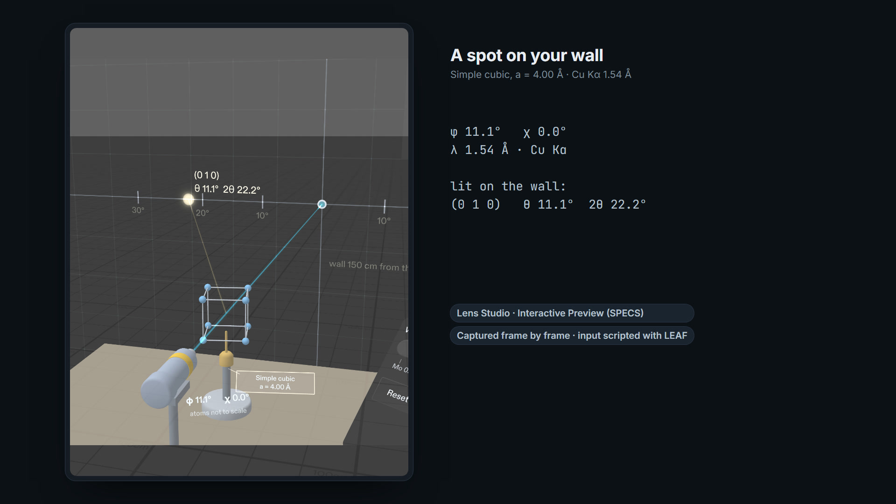

# Bragg's Room



**X-ray diffraction at room scale, for SPECS.** A crystal sits on your desk in the path of an X-ray beam. Turn it with your hand, and when a set of lattice planes meets the Bragg condition, a diffraction spot lights up on your wall at its true scattering angle, with a chime that comes from the spot. Then take on the mission: identify a mystery crystal as simple cubic or face-centred cubic from which reflections appear and which stay dark.

Built for [Learn AR with SPECS](https://learn-specs.devpost.com/). It runs in Lens Studio's Interactive Preview; no SPECS device is needed.

> **Who it's for:** undergraduate physics, chemistry and materials students, and their teachers. Flat textbook diagrams of diffraction don't convey the 3D geometry: how the crystal's orientation, the beam and the spot on the detector are linked. For teachers there's a 30-minute class activity with an answer key: [`devpost/lesson-plan.md`](devpost/lesson-plan.md).

## What you can do

**Free mode** (simple cubic, a = 4.0 Å, Cu Kα λ = 1.54 Å)
- **Turn the crystal** by pinch-dragging it. Left/right spins it about the vertical axis (φ); up/down tilts it about the horizontal axis across the beam (χ, ±45°), like a real two-circle goniometer. It never rolls about the beam. The φ and χ readouts sit on the goniometer base.
- **Find a reflection.** Turn about 11° from the start and the (0 1 0) spot lights up 61 cm to the side of the beam stop: θ = 11.1°, 2θ = 22.2°. A small label by the beam stop says the wall is 150 cm from the crystal, and 150 cm × tan 22.2° = 61 cm. A faint ray joins the crystal to the spot. Turn about 1° further and it goes dark again.
- **Change the wavelength** with the slider (0.70 to 2.30 Å, marked at Mo Kα 0.71, Cu Kα 1.54, Co Kα 1.79 and Cr Kα 2.29 Å). A lit spot moves out as λ goes up and in as λ goes down. Once a reflection has been found, a faint *ghost* keeps showing where it would land at the current wavelength.
- **Switch to FCC** with the lattice toggle and watch the mixed-parity reflections vanish.
- The **evidence board** on the wall lists what you've found, with 2θ and the sin²θ ratio to the lowest-angle reflection (1 : 2 : 3 : 4 : 5 : 6 : 8 for simple cubic).

**Mission: identify the crystal**
- **Start mission** loads a mystery sample. It is randomly SC or FCC, with a ∈ [3.3, 5.7] Å shown on its tag, and the round starts at Mo Kα (0.71 Å). The crystal is drawn as a frosted cube, and spot labels show 2θ only.
- The board states the question, "Simple cubic or face-centred cubic? Find 3 distinct reflections." It logs each distinct reflection you observe (a different d-spacing), and also logs "(100) Bragg condition reached: no spot" or "(110) Bragg condition reached: no spot" when the crystal passes through those conditions and nothing lights.
- **Predict (hkl)**: pick any h, k, l with the steppers to see a ring where that reflection would land. It depends only on a and λ, so it never gives the answer away.
- After three distinct reflections, the **Simple cubic** and **Face-centred cubic** buttons unlock together.
  - SC is supported by any spot that FCC forbids, such as a (100)- or (110)-type spot.
  - FCC is supported when the (100) and (110) Bragg conditions have been reached with no spot **and** a (111) or (200) spot has been seen. That spot is the positive control: it proves the setup could see spots, so the absences mean something.
- A correct verdict says so, for example "Correct: face-centred cubic. Same lattice as aluminium (a = 4.05 Å); this sample: a = 4.22 Å.", reveals every spot's indices and names a real material with the closest lattice parameter (copper, aluminium, rock salt; α-polonium, caesium chloride's primitive cubic lattice). A wrong verdict shows the evidence against it.

## The physics (all angles and directions are real)

The Lens uses the vector (Laue/Ewald) form. The incident wavevector is **k** with |**k**| = 1/λ along the beam. Reciprocal lattice vectors **G** = (h, k, l)/a rotate with the crystal through R = R_χ · R_φ. A reflection lights when |**k** + **G**| ≈ |**k**|, implemented as the glancing angle between the beam and the planes lying within 1.0° of θ_B, where sin θ_B = λ/2d. The diffracted direction is **k**′ = **k** + **G**. The spot is drawn where that ray meets the wall plane 150 cm beyond the crystal, at exactly 2θ_B from the beam and at the azimuth of **k** + **G**. FCC uses the selection rule "h, k, l all even or all odd".

What is deliberately not to scale, and labelled as such in the Lens:
- **Atoms not to scale.** The unit cell is drawn about 8 cm across so you can see it.
- **Mosaic spread exaggerated (1.0°).** A real crystal's rocking width is far narrower; 1.0° makes spots findable by hand.
- **Reflections modelled:** every (hkl) with h² + k² + l² ≤ 12, up to (222). Real crystals also diffract at higher orders; those aren't drawn.
- **All allowed spots are equally bright.** Structure-factor intensities are out of scope.
- **The wall is a stand-in.** On SPECS the detector would sit on your real wall. The preview has no real room, so the Lens draws a virtual wall (a faint grid, 4 m × 2.6 m) and a virtual desk at real size.

The physics lives in [`Assets/Scripts/BraggPhysics.ts`](Assets/Scripts/BraggPhysics.ts), the experiment logic in [`Assets/Scripts/BraggSim.ts`](Assets/Scripts/BraggSim.ts). Both are plain TypeScript with no Lens Studio dependencies, and both are unit-tested against hand-computed values:

| (hkl) | a (Å) | λ (Å) | d (Å) | θ (°) | 2θ (°) | spot distance from beam stop (cm) |
|---|---|---|---|---|---|---|
| (100) | 4.00 | 1.54 | 4.0000 | 11.0987 | 22.1974 | 61.21 |
| (110) | 4.00 | 1.54 | 2.8284 | 15.7974 | 31.5947 | 92.26 |
| (111) | 4.00 | 1.54 | 2.3094 | 19.4765 | 38.9529 | 121.26 |
| (010) | 4.00 | 0.71 | 4.0000 | 5.0917 | 10.1834 | 26.94 |

```sh
cd tests
npm install
npm test        # 124 tests: physics against hand-computed values (18), the experiment logic
                # including every done criterion as pure logic (26), and the room's
                # code-built meshes and layout (80)
npm run table   # prints the table above
npm run reference   # checks the physics against measured aluminium (below)
```

### Checked against real aluminium

When the mission's sample is FCC with a = 4.05 Å, the Lens names it "like aluminium". `npm run reference` checks that against a measured powder pattern of real aluminium: Swanson & Tatge, NBS Circular 539, Vol. I (1953), Table 3, measured with Cu Kα (1.5405 Å) at 23 °C ([doi:10.6028/NBS.CIRC.539v1](https://doi.org/10.6028/NBS.CIRC.539v1), free PDF from NIST). It uses the Lens's own functions in `BraggPhysics.ts`:
- **Selection rule.** The FCC rule allows h² + k² + l² = 3, 4, 8, 11, 12, 16, 19, 20, 24 up to (422), and those are exactly the nine lines that were measured. None of the forbidden ones (1, 2, 5, 6, 9, 10, …) appear.
- **Angles through the vector path.** For each line, the crystal is turned into its exact Bragg condition and the angle between the diffracted ray **k** + **G** and the beam is compared with the 2θ given by the measured d.

| (hkl) | d measured (Å) | d in the Lens (Å) | 2θ from measured d (°) | 2θ in the Lens, k + G (°) |
|---|---|---|---|---|
| (111) | 2.338 | 2.3383 | 38.471 | 38.466 |
| (200) | 2.024 | 2.0250 | 44.737 | 44.713 |
| (220) | 1.431 | 1.4319 | 65.131 | 65.085 |
| (311) | 1.221 | 1.2211 | 78.224 | 78.214 |
| (222) | 1.1690 | 1.1691 | 82.432 | 82.420 |
| (400) | 1.0124 | 1.0125 | 99.072 | 99.059 |
| (331) | 0.9289 | 0.9291 | 112.035 | 111.992 |
| (420) | 0.9055 | 0.9056 | 116.562 | 116.540 |
| (422) | 0.8266 | 0.8267 | 137.444 | 137.407 |

Every d agrees within 0.001 Å and every 2θ within 0.05°. What's left comes from the Lens rounding aluminium's lattice parameter to 4.05 Å (measured: 4.0494 Å) and from the scatter of the measured lines themselves. The Lens itself only draws reflections up to (222), and uses 1.54 Å for Cu Kα.

## Open and run it in Lens Studio

1. Install **Lens Studio 5.23.2 or later**. The project was built and tested in **Lens Studio 5.24.1**; it has not been tested in 5.23.2. Older versions may refuse a project saved by a newer one.
2. Clone this repository and open `braggs-room.esproj`. The packages it needs ship with it: Spectacles Interaction Kit 2.0, Spectacles UI Kit 2.0, and LEAF 2.0.2 with Bitmoji 3D in `Packages/`, plus a small vertex-colour material package in `Assets/SimpleVertexBaseColor.lspkg`. Lens Studio regenerates `Cache/` and `Support/` on first open.
3. In the **Preview** panel, choose the SPECS device and **Interactive Preview** (the default for this project).
4. Click inside the Preview to use the controls:

| Do this | Control |
|---|---|
| Move | **W A S D** |
| Down / up | **Q** / **E** |
| Look around | **Right-drag**, or hold **Shift** and move the mouse |
| Pinch (select, press a button) | **Click** |
| Turn the crystal | **Click and drag** on the crystal: left/right for φ, up/down for χ |
| Change the wavelength | **Drag** the slider handle on the console |

You start at the user's position: the crystal is on the desk in front of you and to the left, the console is to its right, and the wall with the beam stop is 2 m ahead. For the first 10 seconds a bright pulse runs down the beam and "Drag the crystal. Watch the wall." appears above the beam stop. Look down and slightly left to see both the crystal and the wall pattern; the evidence board is on the wall to the right of the beam stop.

In a mission, **Start mission** turns the crystal into a frosted mystery cube. **Predict (hkl)** opens three steppers above the console, and the two verdict buttons appear on the console once you've found three distinct reflections. A small green arrow on the goniometer shows which way to turn toward the nearest reflection, and a chevron at the edge of your view points to a lit spot you can't see.

To start over, press the Preview's reset button: the Lens restarts in free mode at Cu Kα with φ = χ = 0.

## Tests

- **Physics and logic:** `cd tests && npm install && npm test` (Node 20+). The output is in [`devpost/build-report.md`](devpost/build-report.md).
- **LEAF (in the running Lens):** eight scenarios in `Assets/Tests/Leaf/` cover all five done criteria. They're registered in `LeafIndex` and **all eight pass** (315 of 315 sub-checks). To run them, open Lens Studio's LEAF panel and run them in the preview; nothing runs on Lens start. The results per criterion, with the measured values and what LEAF doesn't cover, are in [`devpost/build-report.md`](devpost/build-report.md).

## How it was planned and built

- **Planned with plan-lens.** I ran the `plan-lens` skill from the Learn AR with SPECS skill pack. Its interview checked my idea against AR design practice and against what Lens Studio's preview can do, and produced the approved [`devpost/design-brief.md`](devpost/design-brief.md). I did the interview in Claude Code while away from my keyboard: a relay session passed plan-lens's questions to me and my answers back verbatim. **Every design decision in the brief is mine, from that interview**, except values marked "(default)", which plan-lens filled in for me to review. As a diffraction researcher, I also specified the physics: the vector Laue/Ewald form, a = 4.0 Å and λ = 1.54 Å, the FCC selection rule, and unit tests against hand-computed values.
- **Built by coding agents through CLAD.** AI coding agents (Claude Code with the CLAD plugin) built the Lens, working in Lens Studio through the Lens Studio MCP. CLAD's `specs-experience-builder` agent built the room, the assets and the UIKit console; CLAD's `live-lens-tester` agent wrote the LEAF scenarios, one or more per done criterion (all eight pass); the coding agent wrote the physics module and its unit tests to my specification. [`devpost/build-report.md`](devpost/build-report.md) records the decisions, the iterations, the LEAF results, which choices the agents made during the build rather than me, and what CLAD built versus what it was told to build.
- **Pre-existing code:** none, apart from the Lens Studio Specs Base Template, the Snap packages listed above, and the vertex-colour material that ships with the CLAD plugin.

## Repository layout

```text
Assets/Scripts/      Lens scripts. BraggPhysics.ts, BraggSim.ts, BraggText.ts are pure and unit-tested
Assets/Tests/Leaf/   LEAF scenarios (one or more per done criterion) and LeafIndex
Assets/GeneratedSFX/ chimes, flourish and "not yet" tone, synthesised locally (sources in tools/)
Packages/            SIK 2.0, UIKit 2.0, LEAF 2.0.2, Bitmoji 3D
tests/               command-line unit tests (node:test + TypeScript)
tools/               the scripts that generated the sounds
devpost/             design brief, build report, submission text, video script, lesson plan, CLAD handoffs
```

## Licence

MIT, © 2026 Sarthak. See [LICENSE](LICENSE). The Snap packages in `Packages/` and the CLAD vertex-colour material in `Assets/SimpleVertexBaseColor.lspkg` remain under their own terms.
